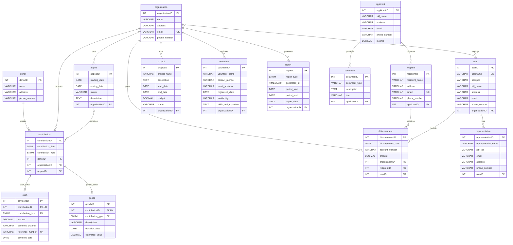

# RANGSIT Aid System — Entity Relationship Diagram

`appealID` on `contribution` and `organizationID` on `user` are optional. The contribution-to-appeal and disbursement-to-user relationships use composite foreign keys with `organizationID`; cash and goods use composite foreign keys with `contribution_type`. A contribution is recorded as either cash or goods through the matching stored procedure.
